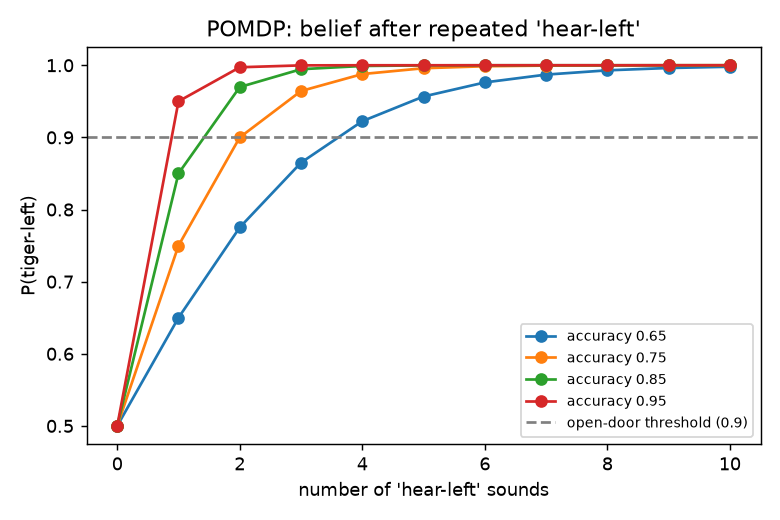
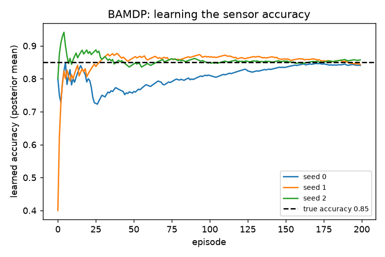
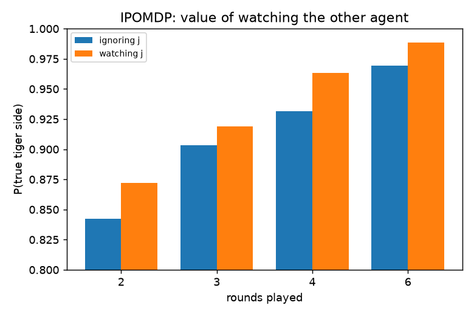

# pomdp-bamdp-ipomdp-library

A small, beginner-friendly Python library that demonstrates three decision-making frameworks under uncertainty:
**POMDP**, **BAMDP** and a **simplified IPOMDP**. Built as a student learning prototype for the
CaCTüS Internship 2027 (Project 8).

> **Honest scope:** this is a teaching prototype on one toy problem (the Tiger problem). It does **not**
> reproduce the full research-level BAMDP / POMDP / IPOMDP theory, and it contains no exact solvers.
> All simplifications are documented in [`docs/methodology.md`](docs/methodology.md).

## Research motivation

Standard MDPs assume the agent sees the full state and knows the rules. Real problems break those
assumptions in three ways, and each framework removes one of them:

| Framework | Hidden thing | Tiger example |
|---|---|---|
| POMDP | current state | which door hides the tiger |
| BAMDP | rules / parameters | how accurate the listening sensor is |
| IPOMDP | another agent's mind | whether another player is hasty or careful |

The same pattern repeats in all three: keep a **belief** about the hidden thing and update it with Bayes' rule.

## Mathematical concepts (short)

* **POMDP belief update:** `b'(s') ∝ Z(o | s', a) · Σ_s T(s' | s, a) · b(s)`
* **BAMDP (Beta-Bernoulli):** belief over sensor accuracy `Beta(α, β)`; each right/wrong sound adds 1 to α/β.
* **IPOMDP (simplified):** joint belief `b(type of other agent, state)`; updated from own hearing and from the other agent's observed actions.

Full derivations and assumptions: [`docs/methodology.md`](docs/methodology.md).

## Architecture

```
decision_library/
  utils.py     probability validation helpers
  pomdp.py     POMDP class, Bayesian belief update, Tiger problem
  bamdp.py     Beta belief over sensor accuracy + learning agent
  ipomdp.py    two-agent Tiger, belief over the other agent's type
examples/      pomdp_demo.py, bamdp_demo.py, ipomdp_demo.py, run_experiments.py
tests/         test_pomdp.py, test_bamdp.py, test_ipomdp.py  (unittest)
docs/          methodology.md
results/       plots (PNG), results.md, saved demo outputs
```

(The package is called `decision_library/` instead of `src/` so imports read `from decision_library.pomdp import POMDP`.)

## Installation

```bash
git clone https://github.com/<your-username>/pomdp-bamdp-ipomdp-library.git
cd pomdp-bamdp-ipomdp-library
python -m venv .venv            # optional
pip install -r requirements.txt
```

Tested with Python 3.12 and NumPy 2.5 (matplotlib 3.11 for the plots); NumPy is the only requirement for the library itself.

## How to run

```bash
python examples/pomdp_demo.py        # Tiger problem, belief updates, one simulated episode
python examples/bamdp_demo.py        # agent learns the sensor accuracy
python examples/ipomdp_demo.py       # agent reasons about another agent
python examples/run_experiments.py   # all experiments, plots and results/results.md
```

## Tests

```bash
python -m unittest discover -s tests -t . -v
```

56 unit tests (POMDP, BAMDP, IPOMDP) check hand-calculated Bayes updates, input validation,
edge cases and reproducibility.

## Actual experimental results

Produced by `examples/run_experiments.py` (fixed seeds, results are reproducible).

All numbers below were produced by `examples/run_experiments.py` (fixed random seeds).

### Experiment 1 - POMDP: does using the belief help? (Tiger, accuracy 0.85)

Average total reward per episode over 5000 episodes (higher is better).

| Policy | Mean reward | Std. error |
|---|---|---|
| Open a random door immediately | -43.00 | 0.78 |
| Belief-based (listen until confident) | 4.21 | 0.26 |

### Experiment 2 - BAMDP: learning the sensor accuracy

200 episodes x 3 listens each, 20 different seeds per row. Error = |learned - true|.

| True accuracy | Mean learned | Mean abs. error | Mean std (uncertainty) | Listens needed (learned) |
|---|---|---|---|---|
| 0.65 | 0.650 | 0.017 | 0.019 | 4.2 |
| 0.75 | 0.750 | 0.016 | 0.018 | 2.5 |
| 0.85 | 0.852 | 0.014 | 0.014 | 2.0 |
| 0.95 | 0.952 | 0.009 | 0.009 | 1.0 |

Reference: an agent with no knowledge (prior Beta(1,1)) needs 55 listens.

### Experiment 3 - simplified IPOMDP: does watching the other agent help?

2000 random trials per row (random tiger side, random type of j). Value = average probability agent i assigns to the TRUE tiger side.

| Rounds | Watching j | Ignoring j | Difference |
|---|---|---|---|
| 2 | 0.8722 | 0.8422 | +0.0299 |
| 3 | 0.9187 | 0.9036 | +0.0152 |
| 4 | 0.9634 | 0.9316 | +0.0318 |
| 6 | 0.9884 | 0.9696 | +0.0188 |

Plots: `results/pomdp_belief.png`, `results/bamdp_learning.png`, `results/ipomdp_watching.png`.





How to read these results (and what they do not show):

* Experiment 1 only shows that a belief-based rule beats guessing on this toy problem; it is not compared with an optimal POMDP solver.
* Experiment 2 shows the learned accuracy approaching the true one with shrinking uncertainty. The agent plans with the posterior mean, not with full Bayes-adaptive planning.
* Experiment 3 shows a small but consistent gain from watching the other agent. The gain depends on the hand-written types and the fixed rule for agent j.

## Limitations

* One toy problem (Tiger); small discrete spaces.
* Greedy one-step decisions; no exact or approximate long-horizon solvers.
* BAMDP: one unknown parameter, plug-in (posterior-mean) planning, state revealed after each episode.
* IPOMDP: one nesting level, two hand-written types, agent j follows a fixed rule.

## Future work

Point-based POMDP solvers, a Bayes-adaptive planner over (state, parameters), Dirichlet priors for unknown
transition models, level-2 IPOMDP with solved opponent policies, more environments (e.g. grid worlds).

## License

MIT, see [`LICENSE`](LICENSE).
